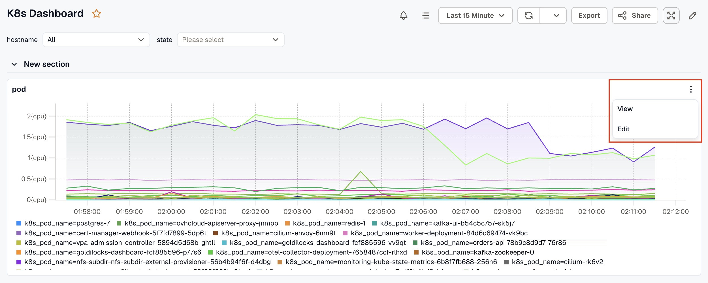
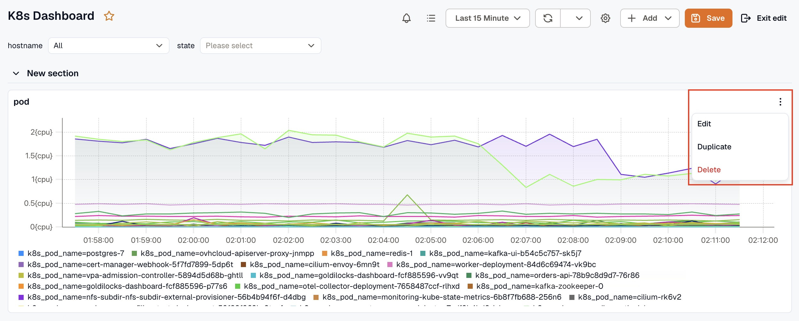
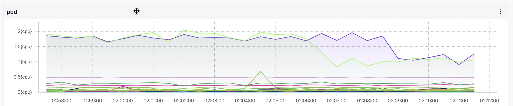
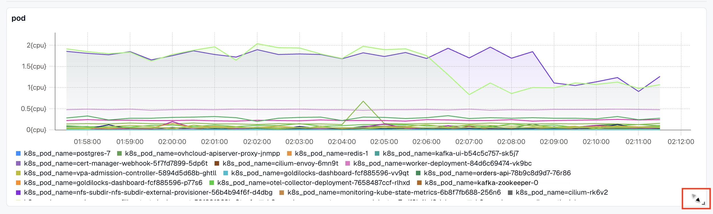

Panel management actions are available in two modes, view mode and edit mode. Some actions are only available once you enter edit mode by clicking the **Edit** icon in the dashboard toolbar.

### View Mode

In view mode, click the more options (⋯) icon on any panel to access:

- **View:** Opens the panel in a focused full view for a closer look at the data.
- **Edit:** Opens the panel editor to modify the query, visualization, or settings.
- **Inspect:** Shows the data and JSON behind the panel. See [Inspect a panel](#inspect-a-panel).
- **Create alert:** Opens a new alert rule built from the panel's query. See [Create an alert from a panel](#create-an-alert-from-a-panel).

### Edit Mode

In edit mode, click the more options (⋯) icon on any panel to access:

- **Edit:** Opens the panel editor to modify the query, visualization, or settings.
- **Inspect:** Shows the data and JSON behind the panel.
- **Create alert:** Opens a new alert rule built from the panel's query.
- **Duplicate:** Creates a copy of the panel on the same dashboard. Useful when you need a similar panel with minor query differences.
- **Delete:** Removes the panel from the dashboard.

### Inspect a panel

**Inspect** opens the data behind a panel, which helps when a panel draws something you don't expect. It's also in the panel editor's header. The tabs are:

- **Data frames:** The query response as it arrived, before anything was hidden or reshaped.
- **Panel data:** What the panel draws: the data after hidden queries and [transformations](../panel-options/transformations/), with the time window and the query state.
- **Panel JSON:** The panel's definition, which is what saving the panel writes. See [Dashboard JSON and API](../dashboard-json-and-api/).
- **Query:** The query nodes as they were sent, with variables replaced by their values.

Use the copy action to copy the tab's contents.

### Create an alert from a panel

Click **Create alert** in the panel menu to open the alert editor with the panel's first query already filled in. Set a threshold before you save. **Create alert** appears only on a saved dashboard, and not on a public dashboard. See [Create an alert from a dashboard panel](../../../alerts/create-alerts/#create-an-alert-from-a-dashboard-panel).

On a TimeSeries panel, you can also start from a value on the chart. Click a point to pin the tooltip, then click **Create alert at this value**. The new alert uses that value as its threshold. Click the close icon, click elsewhere, or scroll the page to unpin the tooltip.

To mark an event on the chart instead, hold **Cmd** or **Ctrl** while you click. See [Annotations](../annotations/).

### Reposition a Panel

In edit mode, a drag handle (move icon) appears at the top-center of each panel. Click and drag it to move the panel to a different position on the dashboard. This helps you arrange panels in a layout that makes the most sense for your workflow.

### Resize a Panel

In edit mode, a resize handle appears at the bottom-right corner of each panel. Click and drag it to make the panel larger or smaller. Resizing lets you give more space to the metrics you care about most.
