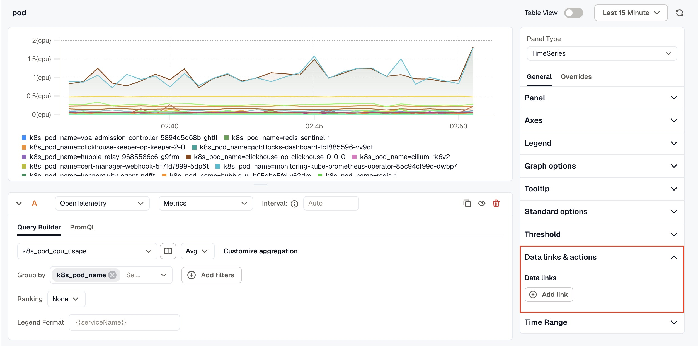
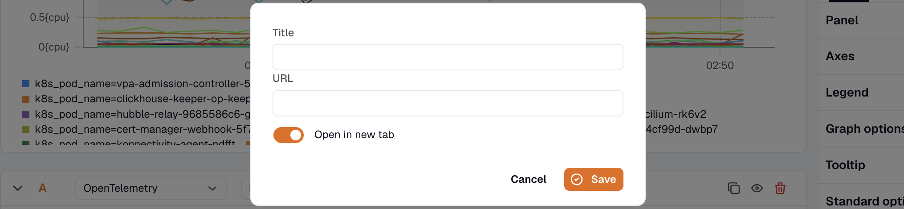

A data link turns a value on a panel into a link, with details of that value filled into the URL. Use one to open the runbook for the host a tile shows, or another dashboard filtered to the service in a table row. Data links are on TimeSeries, Stats, Gauge, and Table panels.

For links in the dashboard header, see [Adding links to dashboards](../../adding-links-to-dashboards/).

## Add a data link

1. Edit the panel. On the **Options** tab, open **Data links & actions**.

   

2. Under **Data links**, click **Add link**.
3. Enter a **Title**. It can use the same variables as the URL, for example `Open ${__field.name}`.
4. Enter the **URL**. Type `$` to open the list of [variables](#variables-you-can-use-in-the-url) and insert one.
5. Turn on **Open in new tab** if the link should open in a new browser tab.
6. Click **Save**.

   

A link added on the **Options** tab appears on every series, column, or tile in the panel. To add a link to only some fields, such as one table column, add an [override](../overrides/) with the **Data links & actions** property.

Some data sources put links on a field themselves (see [Links from the data source](#links-from-the-data-source)). On a field:

- Links from the **Options** tab are added to the data source's links.
- Links from an override rule are added to the **Options** tab links, and **replace** the data source's links on the fields the rule matches. Remove the rule's last link to bring the data source's links back.

A link with the same title and URL appears once.

## Variables you can use in the URL

| Variable | Inserts |
|---|---|
| **Series name** (`${__series.name}`) | The series' name as the legend shows it, or the field name when there's no legend name. |
| **Field name** (`${__field.name}`) | The name of the field. |
| **Field Label:** `<key>` (`${__field.labels["<key>"]}`) | The value of that label on the field. The list has one entry per label key in the data. |
| **Value numeric** (`${__value.numeric}`) | The raw number, before formatting. A tile that shows `0.13` links with `0.125`. |
| **Value time** (`${__value.time}`) | The time of the value, in epoch milliseconds. On a Stats or Gauge tile, it's the time of the series' last point. In a table, it's the row's time, so it's empty when the table has no time column. |
| **Dashboard variable:** `<label>` | `var-<name>=${<name>}`, the variable's current selection as a query parameter. Use it to open another dashboard with the same selection. See [Dashboard variables](../../dashboard-variables/). |
| **Time range** (`${__time_range}`) | The dashboard's time range and time zone as query parameters. For example, `/logs?${__time_range}` becomes `/logs?timeRange=now-1h&tz=Asia%2FKolkata`. |
| **From** (`${__from}`), **To** (`${__to}`) | The start and end of the dashboard's time range, in epoch milliseconds. |
| **Workspace ID** (`${__workspace_id}`) | The ID of the current workspace. |

You can also type these by hand. They aren't in the `$` list:

- `${__value.raw}` is the clicked value before formatting, such as the id in a table cell.
- `${__data.fields.<name>}` is another value from the same table row, including hidden columns.
- `:kmql` writes a value as a [KMQL](../../../kmql/) value, quoted when needed, and a list as comma-separated values for `in ( )`. For example, `/logs?q=service.name = ${__field.labels["service.name"]:kmql}`.

For example, this URL opens a runbook page for the host a value belongs to:

```text
https://runbooks.example.com/hosts/${__field.labels["host.name"]}
```

Every value inserted into the URL is URL-encoded, so a series named `checkout api` arrives as `checkout%20api`. Values in the title aren't encoded. To insert a value without encoding, add `:raw` inside the braces, for example `${__field.name:raw}`.

A variable at the very start of the URL is inserted as it is, so it can supply the scheme and host, as in `${base}/status` or a `${__value.raw}` that holds a full URL. Values after it are still encoded, and the result still has to be one of the URLs below.

## URLs a link can use

A link's URL must be one of these:

- An `http://` or `https://` address.
- A `mailto:` address.
- A path inside KloudMate that starts with a single `/`, such as the path of another dashboard copied from your browser's address bar.

The link editor won't save any other URL, such as `example.com/status` with no scheme, `//example.com`, or a `javascript:` URL. A URL that starts with a variable, such as `${base}/status`, is checked when the panel draws the link. If the result isn't one of the forms above, the link doesn't appear on the panel.

## Where links open

- **TimeSeries**: click a point to pin the tooltip. It lists the data links of the series you clicked.
- **Stats** and **Gauge**: click a tile to open a menu of its links.
- **Table**: when a cell has one link, the cell's value is the link. When it has several, clicking the value opens a list of them. Set the column's **Cell type** to **Links** under **Cell options** to show the links in the cell itself. Empty cells don't get links.

## Links from the data source

A **Records** table of logs or traces comes with links on its id columns:

- `id` opens the log in Log Explorer (**View log**).
- `traceId` opens the trace (**View trace**).
- `spanId` opens the trace with that span selected (**View span**).

An empty id cell has no link. To replace these links on a column, add an override with **Data links & actions** on that column. Links on the **Options** tab are added beside them.

***

## Related

- [Overrides](../overrides/)
- [Dashboard variables](../../dashboard-variables/)
- [Adding links to dashboards](../../adding-links-to-dashboards/)
- [Panel options](../)
