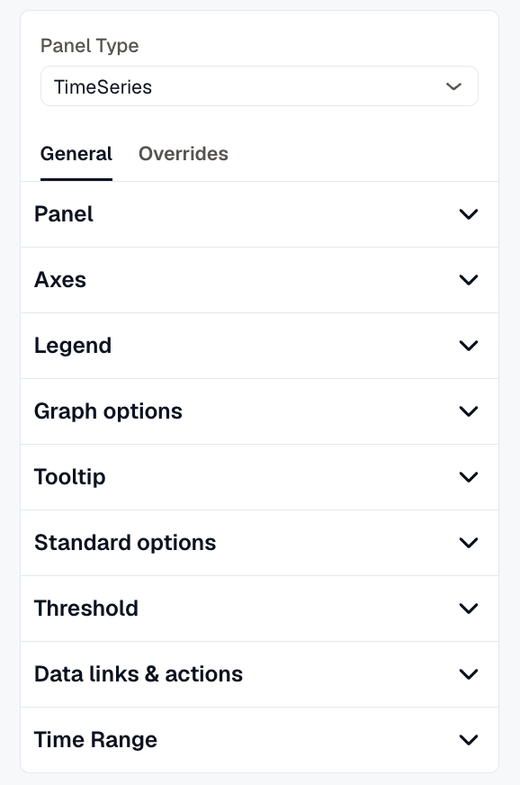

Panel options control how a panel draws the values its queries return: the unit and number style, colors, thresholds, value mappings, and data links. You set them in the panel editor, in the settings pane on the right.

## Where the settings live

The settings pane has tabs for **Options**, **Transform**, and **Overrides**:

- **Options** holds the settings for the whole panel. A setting here applies to every series, column, or tile the panel draws.
- **Transform** reshapes the query results before the panel draws them, for example to join two queries into one table or to reorder table columns. See [Transformations](./transformations/).
- **Overrides** holds rules that change settings for only the fields a rule matches, such as one series on a chart or one column in a table. See [Overrides](./overrides/).

**Alerts List** and **Issues List** panels have only the **Options** tab, with the **Panel** and **Time range** sections.

## Standard options

Every panel type that draws values has a **Standard options** section on the **Options** tab. Some of its options only appear on the panel types that can use them:

| Option | What it does | Panel types |
|---|---|---|
| **Display name** | Renames the series, column, or tile. Leave it empty to keep the name from the query. | All except Alerts List and Issues List |
| **Range** | Sets the **Min** and **Max** a value is drawn against, such as the ends of a gauge's arc. | Stats, Gauge, Table |
| **Format** | Sets the unit and how numbers are written. Histogram and Heatmap panels have **Bucket format** instead, which formats the bucket boundaries. | All except Alerts List and Issues List |
| **Color scheme** | Picks how values or series are colored. | TimeSeries, Stats, Gauge, Table |
| **No-data value** | Sets what a tile shows when its query returns no value, such as `0`. | Stats |

A **Display name** set on the **Options** tab renames every series in the panel. To rename a single series or column, set **Display name** in an [override rule](./overrides/) instead.

## Options apply to everything, overrides to what they match

An option you set on the **Options** tab applies to every series, column, or tile in the panel. An override rule applies only to the fields it matches. When both set the same option for a field, the override wins.

For example, set **Unit** to **Milliseconds** on the **Options** tab, then add an override that sets **Bytes** for the `heap_used` series. That series is written in bytes, and every other series keeps milliseconds.

## The unit comes from the metric

When you haven't set a unit, the panel uses the unit the metric declares. A metric reported in bytes is written in bytes and a metric reported in seconds is written as a duration, with no setup. Set **Unit** only when the data doesn't declare one or you want a different one. See [Format values and units](./format-and-units/).

## Sections on each panel type

The **Options** tab shows these sections, in this order:

| Panel type | Sections |
|---|---|
| TimeSeries | **Panel**, **Standard options** (Display name, Format, Color scheme), **Axes**, **Legend**, **Graph options**, **Tooltip**, **Axis placement**, **Threshold**, **Data links & actions**, **Value mappings**, **Annotations**, **Time range** |
| Stats | **Panel**, **Standard options** (Display name, Range, Format, Color scheme), **Calculations**, **Rename**, **Stat options**, **Threshold**, **Data links & actions**, **Value mappings**, **Time range** |
| Gauge | **Panel**, **Standard options** (Display name, Range, Format, Color scheme), **Calculations**, **Gauge**, **Threshold**, **Data links & actions**, **Value mappings**, **Time range** |
| Table | **Panel**, **Standard options** (Display name, Range, Format, Color scheme), **Cell options**, **Column layout**, **Value mappings**, **Threshold**, **Data links & actions**, **Time range** |
| Pie Chart | **Panel**, **Standard options** (Display name, Format), **Value options**, **Display**, **Legend**, **Time range** |
| Bar Chart | **Panel**, **Standard options** (Display name, Format), **Display**, **Axes**, **Legend**, **Time range** |
| Histogram | **Panel**, **Standard options** (Display name, Bucket format), **Axes**, **Legend**, **Time range** |
| Heatmap | **Panel**, **Standard options** (Display name, Bucket format), **Display**, **Time range** |
| Text | **Panel**, **Standard options** (Display name, Format), **Content** |
| Alerts List, Issues List | **Panel**, **Time range** |

The options specific to one panel type are covered on that panel's page under [Adding a Panel](../adding-a-panel/).

***

## Related

- [Format values and units](./format-and-units/)
- [Thresholds](./thresholds/)
- [Colors and value mappings](./colors-and-value-mappings/)
- [Overrides](./overrides/)
- [Data links](./data-links/)
- [Transformations](./transformations/)
