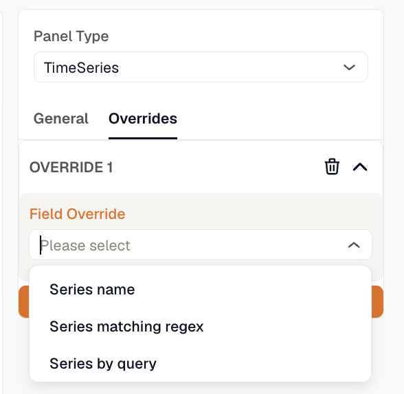

An override changes panel options for only the fields it matches: one series on a chart, one column in a table, or every field from one query. Use overrides to put a single series on a right-hand axis, give a series a fixed color, or rename and resize a table column.

The **Overrides** tab is in the panel editor on every panel type except Alerts List and Issues List.

## Add an override rule

1. Open the **Overrides** tab and click **Add Field Override**.
2. Pick a matcher from the menu. The rule is added as **Override 1**, with the matcher under **Applies to**.
3. Fill in the matcher's value, for example the name of the series.
4. Click **Add Override Property**, choose the option to change, and set it.
5. Repeat the previous step for each other option the rule should change.

Run the query before you add a rule. The field names offered in **Values** and the label keys offered in **Label** come from what the panel currently draws.

## Choose what a rule applies to

| Matcher | What it matches |
|---|---|
| **Fields with names** | The fields you pick in **Values**, by their name or their display name. |
| **Fields with name matching regex** | Every field whose name matches the regular expression in **Value**. |
| **Fields with type** | Every field of the type you pick in **Value**: **Time**, **Number**, **Text**, **True or false**, **Enum**, **JSON**, or **Other**. |
| **Fields with label** | Every field that carries the label you pick in **Label**, with the value you pick in **Value**. You can also type a value that isn't in the list. |
| **Fields returned by query** | Every field from the query you pick in **Value**, such as `A` or `B`. |

A regular expression is tested against the field's original name, not its **Display name**, so renaming a field doesn't change what the rule matches. The match is case-sensitive and can fall anywhere in the name: `latency` matches `http.server.latency`, and `Latency` doesn't. Add `^` and `$` to match the whole name. An empty or invalid expression matches nothing.

## Properties a rule can set

A rule can set the options from the **Options** tab that can differ from one field to the next:

| Panel type | Properties |
|---|---|
| TimeSeries | **Display name**, **Format**, **Graph options**, **Color scheme**, **Axis placement**, **Threshold**, **Data links & actions**, **Value mappings** |
| Stats | **Display name**, **Range**, **Calculations**, **Format**, **Color scheme**, **Threshold**, **Data links & actions**, **Value mappings** |
| Gauge | **Display name**, **Range**, **Calculations**, **Format**, **Color scheme**, **Threshold**, **Data links & actions**, **Value mappings** |
| Table | **Display name**, **Range**, **Cell options**, **Column layout**, **Format**, **Color scheme**, **Value mappings**, **Threshold**, **Data links & actions** |
| Pie Chart, Bar Chart, Text | **Display name**, **Format** |
| Histogram, Heatmap | **Display name**, **Bucket format** |

## How rules combine

An override wins over the **Options** tab for the fields it matches. Rules are applied in order, starting with **Override 1**, so when two rules set the same property on a field, the later rule wins.

Threshold steps and value mappings in a rule replace the panel's steps or mappings for that field instead of adding to them. Data links are the exception: links from a rule are added to the links from the **Options** tab, and the field shows both.

## Examples

### Put one series on the right axis

A TimeSeries panel that shows request rate and latency together is hard to read when both share one axis. Move latency to its own axis:

1. Click **Add Field Override** and pick **Fields with names**.
2. In **Values**, pick the latency series.
3. Click **Add Override Property**, choose **Axis placement**, and select **Right**.

The series moves to a Y axis on the right, which is written in that series' unit. To pin the ends of that axis, set **Min** and **Max** under **Y-Axis (right)** in the **Axes** section of the **Options** tab.

### Give one series a fixed color

To make an `errors` series always draw in red while the other series keep their palette colors:

1. Click **Add Field Override** and pick **Fields with names**.
2. In **Values**, pick the `errors` series.
3. Click **Add Override Property**, choose **Color scheme**, select **Single color**, and pick red with the swatch.

### Rename and resize a table column

To show a `service.name` column as **Service** with a fixed width:

1. Click **Add Field Override** and pick **Fields with names**.
2. In **Values**, pick `service.name`.
3. Click **Add Override Property**, choose **Display name**, and enter `Service`.
4. Click **Add Override Property** again, choose **Column layout**, and set **Width** to `200`. Set **Align** to **Left**, **Center**, or **Right** if you need to.

To reorder or hide table columns, use the [Organize fields](../transformations/#organize-fields) transformation.

***

## Related

- [Panel options](../)
- [Format values and units](../format-and-units/)
- [Colors and value mappings](../colors-and-value-mappings/)
- [Transformations](../transformations/)
- [Table panel](../../adding-a-panel/table-panel/)
