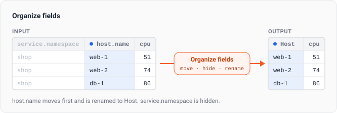
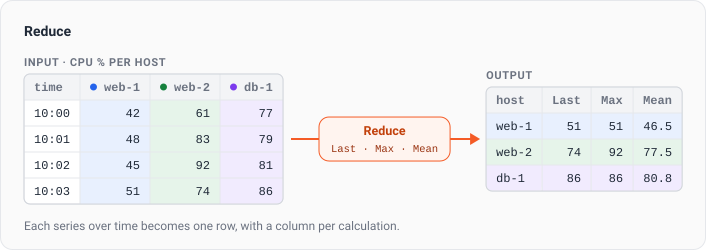
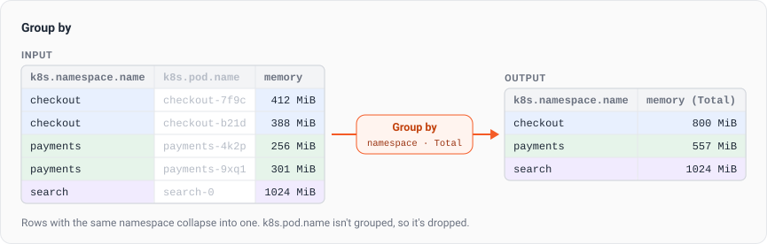
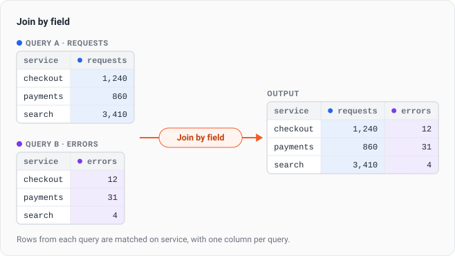
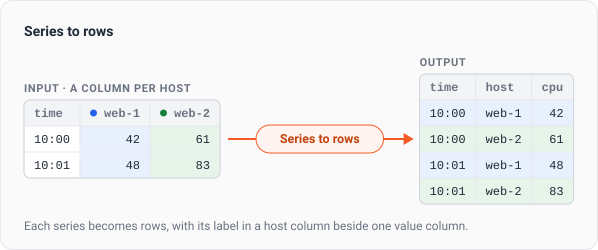
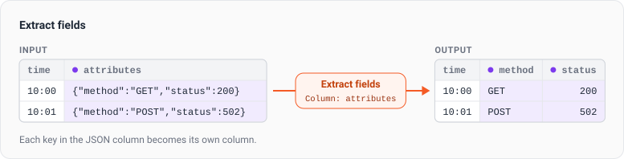
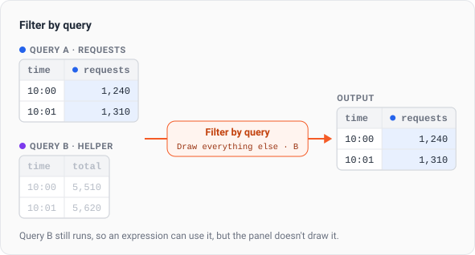
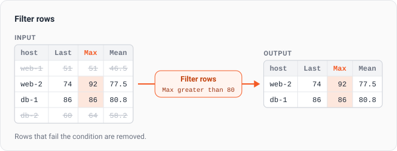
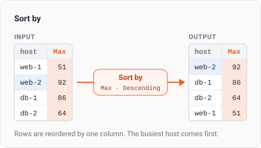

Transformations reshape the query results before the panel draws them. Use them to join two queries into one table, collapse each series over time into a row of numbers, or reorder and rename table columns. They're on the **Transform** tab of the panel editor, on every panel type except Alerts List and Issues List.

## Add a transformation

1. Run the query, so the steps that pick columns or queries have something to list.
2. On the **Transform** tab, click **Add transformation** and pick a step.
3. Fill in the step's fields. The panel preview updates as you edit.

Steps run from top to bottom, and each step works on the output of the step above it. Drag a step by its handle to change the order. Turn a step off with its switch to skip it while keeping its settings, or click **Remove** to delete it. The steps are kept when you switch to another panel type that has a **Transform** tab.

To see what a step changes, click **Inspect data** on it. The **Input** tab shows the data the step receives, and the **Output** tab shows what it passes on.

## Organize fields

Reorder, hide, and rename columns. The step lists one row per column. Drag a row to move the column, turn off its switch to hide it, and type a new name in its box to rename it.

This is how you set the column order on a Table panel. For example, drag `host.name` to the top, hide `service.namespace`, and rename `host.name` to `Host`.

A renamed column keeps its original name for [override](../overrides/) rules, so rules that match it by name still apply.

## Reduce

Collapse each series over time into one row, with a column per calculation. Pick one or more **Calculations**: **Last**, **First**, **Min**, **Max**, **Mean**, **Total**, **Count**, **Difference**, or **Range**. The step does nothing until you pick at least one.

For example, a query for CPU usage per host draws a line per host. On a Table panel, add **Reduce** with **Last**, **Max**, and **Mean** to get one row per host, with the host's labels as columns and a column each for **Last**, **Max**, and **Mean**. When the labels don't tell two series apart, a **Field** column holds each series' name.

Only results with a time axis are reduced. Results that already have one value per series pass through unchanged.

**Total** adds up the points in the series. On a rate series, that sum isn't a count of events.

## Group by

Collapse rows that share the same values, and reduce the numbers in each group. Pick the columns that identify a row in **Group by**. Then, for each number column, pick the calculations to apply. Leave a number column empty to drop it.

For example, a table of pods with `k8s.namespace.name`, `k8s.pod.name`, and memory usage can be grouped by `k8s.namespace.name` with **Total** on memory usage, to show one row per namespace with the memory of all its pods. Text columns that aren't in **Group by**, such as `k8s.pod.name` here, are dropped.

## Join by field

Merge the queries on the dimensions they share, with one row per set of dimension values and a column for each query. The step has no fields.

For example, query A returns the request count per service and query B returns the error count per service, both as a single value. **Join by field** gives one row per service, with the request count and the error count side by side.

Queries that return values over time are left alone, because joining them would give a row per time bucket. Add a **Reduce** step above **Join by field** to join them.

## Series to rows

Turn one column per series into rows, with the series' labels as columns beside a single value column. A result over time keeps its time column, so a column per host becomes `time`, `host`, and a value column. Use it when you want to hide, rename, format, filter, or sort on a label as a column.

**Value column name** names the value column. Leave it empty to keep the measurement's own name. A result that already has one value column doesn't change.

## Extract fields

Open a JSON column into a column per key. Pick the JSON column in **Column**. Turn on **Keep the original column** to keep the JSON column beside the new ones.

For example, pick the `attributes` column of a table of log records to get a column for each attribute.

## Filter by query

Draw only some of the panel's queries. Choose **Draw only these** to keep the queries you pick in **Queries**, or **Draw everything else** to hide them.

For example, choose **Draw everything else** and query `B` to hide a query that only feeds an expression.

## Filter rows

Keep only the rows whose values pass a test. Each condition has a **Column**, a **Test**, and a **Value**. The tests are **equals**, **does not equal**, **greater than**, **at least**, **less than**, **at most**, **contains**, **does not contain**, **is empty**, and **is not empty**.

Click **Add condition** to add more, then choose **Match all** to keep rows that pass every condition, or **Match any** to keep rows that pass at least one.

For example, after a **Reduce** step, set **Column** to **Max**, **Test** to **greater than**, and **Value** to `80` to keep only the hosts that went above 80.

## Sort by

Order the rows by one column. Pick the column in **Column**, then choose **Ascending** or **Descending**.

For example, after a **Reduce** step, sort by **Max** in **Descending** order to put the busiest host first.

***

## Related

- [Overrides](../overrides/)
- [Table panel](../../adding-a-panel/table-panel/)
- [Panel options](../)
