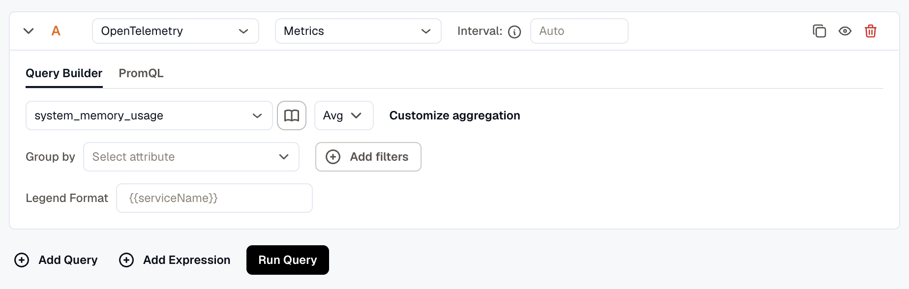
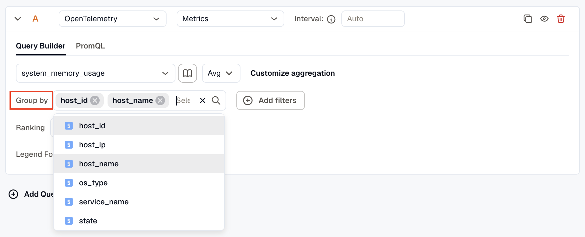
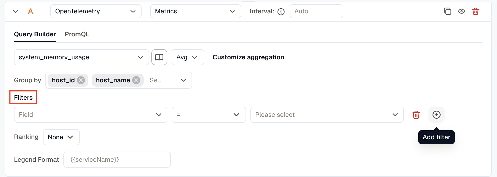
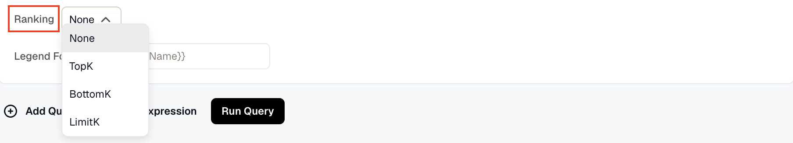
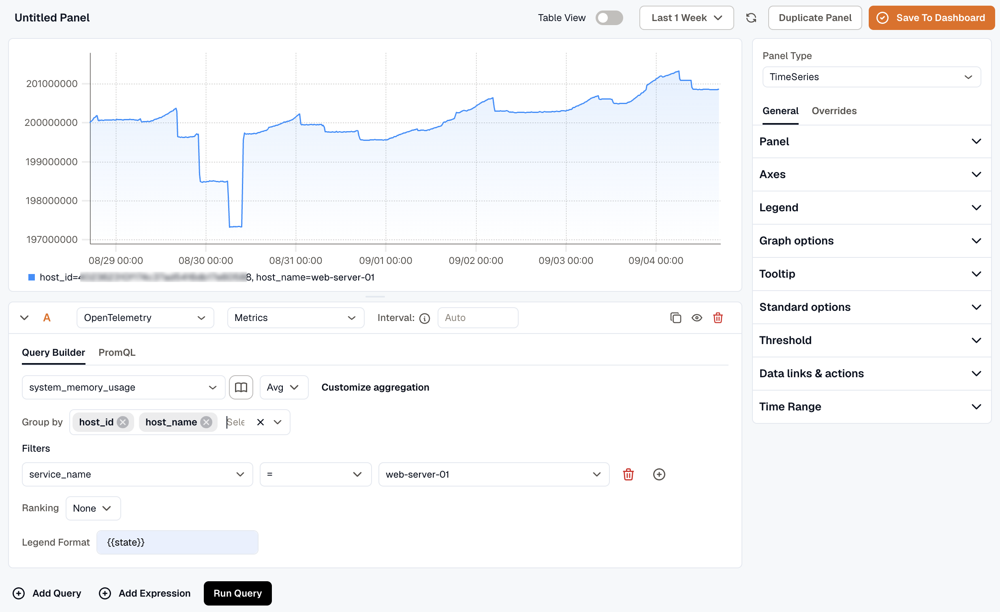
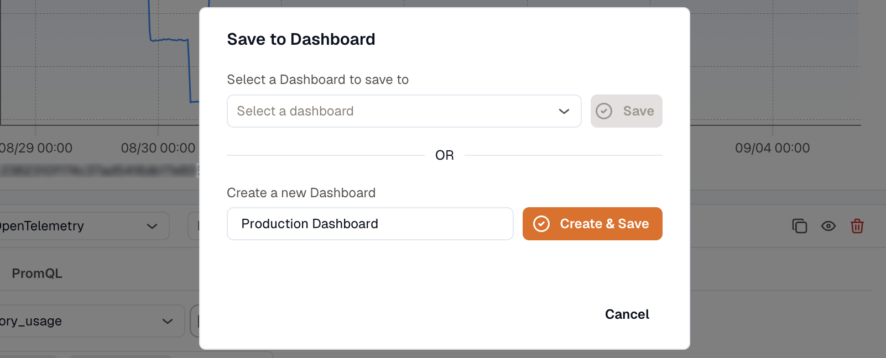

import { Image } from 'astro:assets';
import explorePanelType from './images/explore-panel-type.png';
import exploreGeneral from './images/explore-general.png';
import exploreOverrides from './images/explore-overrides.png';

Explore is the ad hoc query workspace in KloudMate. Use it to build and check a query on metrics, logs, or traces before you add it to a dashboard. It uses the same query editor and panel settings as the dashboard panel editor.

This walkthrough focuses on metrics.

## Explore Walkthrough

1. **Navigate to Explore**
   Open the Explore section from the left-hand navigation menu. A new untitled panel opens immediately.

2. **Configure the Visualization**
   Use the **Panel Type** dropdown to choose how results are displayed: **TimeSeries**, **Stats**, **Gauge**, **Table**, **Pie Chart**, **Bar Chart**, **Histogram**, **Heatmap**, **Alerts List**, **Issues List**, or **Text**. A type that can't draw the query is greyed out, with the reason under its name.

   <Image src={explorePanelType} alt="The Panel Type dropdown, listing TimeSeries, Stats, Gauge, Table, Pie Chart, Bar Chart, Histogram, Heatmap, Alerts List, Issues List, and Text." width={323} densities={[1, 2]} />

   Below it, the settings panel splits into tabs:

   - **Options** sets the panel's appearance, such as the unit, axes, legend, and thresholds.
   - **Transform** reshapes the result before the panel draws it, for example to sort rows or join two queries.
   - **Overrides** changes the display of specific fields only, matched by name, a regex, type, label, or query.

   See [Panel Options](../dashboards/panel-options/) for every setting.

   <Image src={exploreGeneral} alt="The Options tab" width={317} densities={[1, 2]} />

   <Image src={exploreOverrides} alt="The Overrides tab" width={323} densities={[1, 2]} />

3. **Choose the Data Source and Signal Type**
   At the top of the query editor, select **KloudMate** as the data source and **Metrics** as the data set. Connected AWS accounts are listed by account name with **CloudWatch** under them, and HTTP endpoint connections with **HTTP endpoint**. See [Queries and Data Sources](../dashboards/adding-a-panel/queries-and-data-sources/) for each source.

   Keep **Interval** on **Auto** unless you need a specific rollup interval. On panel types other than TimeSeries, **Returns** sets whether the query computes a value for each time step or a single value for the whole range.

   For logs or traces, choose the **Logs** or **Traces** data set instead. The **Aggregation** tab computes values, such as an error count per service, and the **Records** tab lists the individual log records or spans in a **Table** panel.

4. **Build the Query**
   In the Query Builder, select a metric name and choose an aggregation function such as `Avg`, `Sum`, `Min`, or `Max`.

   

   - Click **Customize aggregation** to set **Aggregation within series** and **Aggregation across series** separately. See [Metrics Aggregations](./metrics-aggregations/) for details.
   - Use **Group by** to break down the metric by one or more attributes, such as `host_id` or `host_name`.

   

   - Use **Add filters** to narrow the results by attributes. Each filter needs a field, an operator, and a value, for example `service_name = checkout-api`.

   

   - Use **Ranking** to control how series are ordered.

   

   - Use **Legend Format** to customize series labels.
   - Switch to the **PromQL** tab to write a raw query expression instead. Use its search bar to jump to a keyword in a long query.

5. **Add Queries and Expressions**
   Use **Add Query** to compare multiple metric series in one panel. If one query fails, its error shows under the header and the other queries still draw.

   Use **Add Expression** to derive values from existing queries, including math, reduce, and condition expressions. See [Alert Expressions](../../alerts/expressions/) for the full expression syntax.

6. **Run the Query**
   Click **Run Query** to execute the query and render the result.

   

7. **Save to a Dashboard**
   When the query looks right, use **Save to Dashboard** to add the panel to an existing dashboard or create a new one.

   

## Related

- [Metrics Aggregations](./metrics-aggregations/)
- [Queries and Data Sources](../dashboards/adding-a-panel/queries-and-data-sources/)
- [Create a Dashboard](../../visualize-data/dashboards/create-a-dashboard/)
