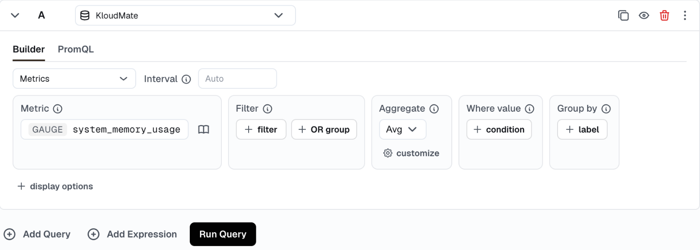
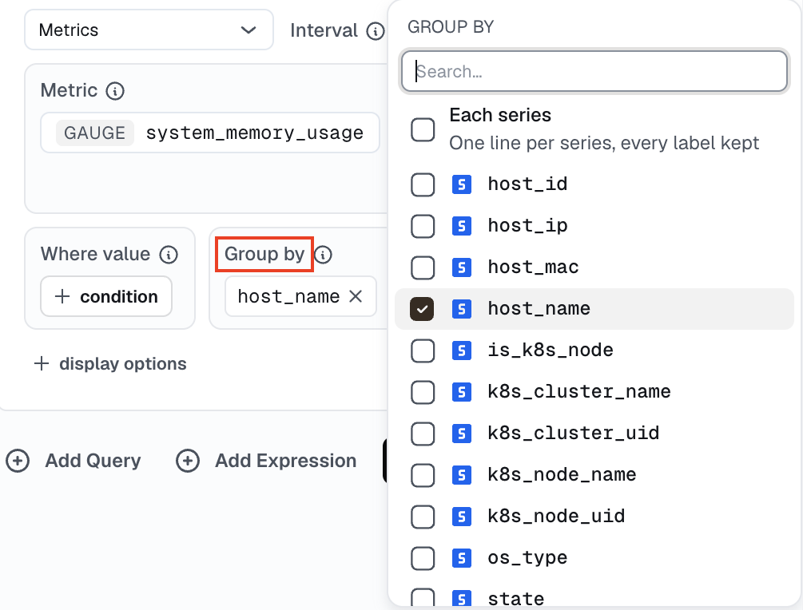
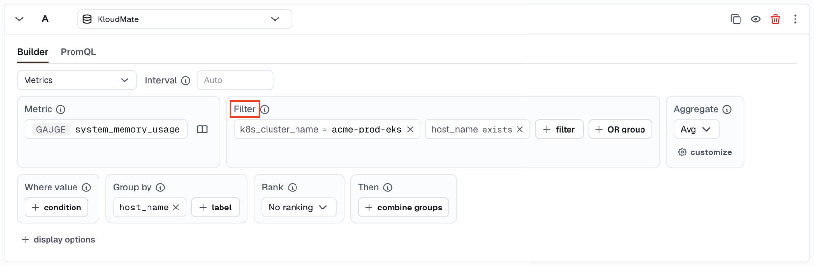
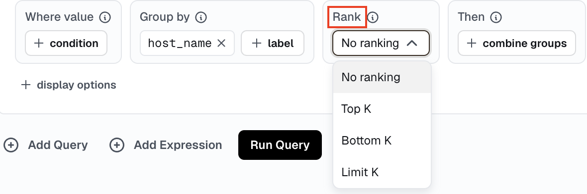
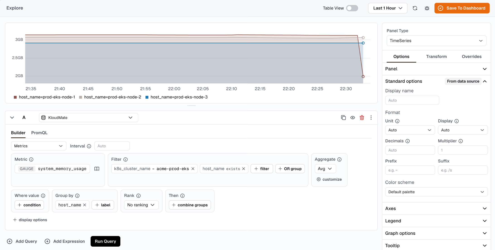
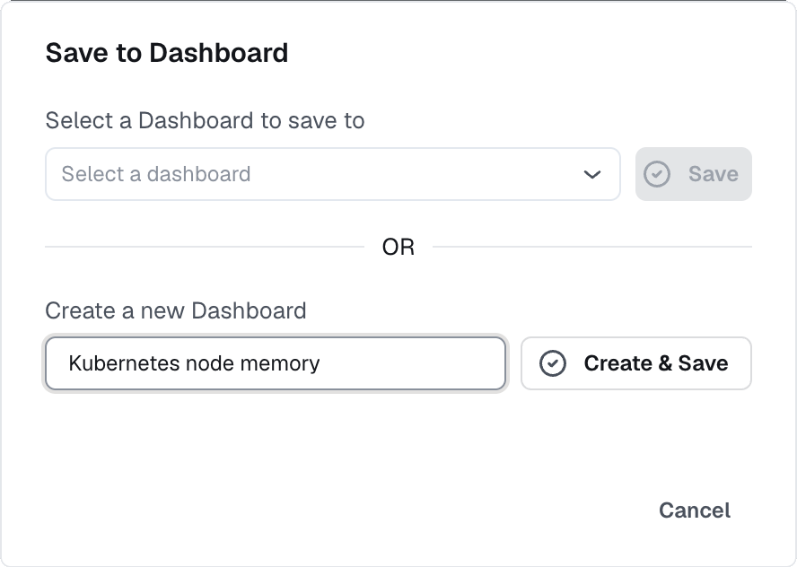

import { Image } from 'astro:assets';
import explorePanelType from './images/explore-panel-type.png';
import exploreGeneral from './images/explore-general.png';
import exploreOverrides from './images/explore-overrides.png';

Explore is the ad hoc query workspace in KloudMate. Use it to build and check a query on metrics, logs, or traces before you add it to a dashboard. It uses the same query editor and panel settings as the dashboard panel editor.

This walkthrough focuses on metrics.

## Explore Walkthrough

1. **Navigate to Explore**
   Open the Explore section from the left-hand navigation menu. A new untitled panel opens immediately.

2. **Configure the Visualization**
   Use the **Panel Type** dropdown to choose how results are displayed: **TimeSeries**, **Stats**, **Gauge**, **Table**, **Pie Chart**, **Bar Chart**, **Histogram**, **Heatmap**, **Alerts List**, **Issues List**, or **Text**.

   <Image src={explorePanelType} alt="The Panel Type dropdown, listing TimeSeries, Stats, Gauge, Table, Pie Chart, Bar Chart, Histogram, Heatmap, Alerts List, Issues List, and Text, each with a one-line description." width={411} densities={[1, 2]} />

   Below it, the settings panel splits into tabs:

   - **Options** sets the panel's appearance, such as the unit, axes, legend, and thresholds.
   - **Transform** reshapes the result before the panel draws it, for example to sort rows or join two queries.
   - **Overrides** changes the display of specific fields only, matched by name, a regex, type, label, or query.

   See [Panel Options](../dashboards/panel-options/) for every setting.

   <Image src={exploreGeneral} alt="The Options tab, with sections for Panel, Standard options, Axes, Legend, Graph options, Tooltip, Axis placement, Threshold, Data links & actions, Value mappings, Annotations, and Time range" width={317} densities={[1, 2]} />

   <Image src={exploreOverrides} alt="The Overrides tab with the Add Field Override menu open, listing Fields with names, Fields with name matching regex, Fields with type, Fields with label, and Fields returned by query" width={317} densities={[1, 2]} />

3. **Choose the Data Source and Signal Type**
   At the top of the query editor, select **KloudMate** as the data source and **Metrics** as the data set. Connected AWS accounts are listed by account name with **CloudWatch** under them, and HTTP endpoint connections with **HTTP endpoint**. See [Queries and Data Sources](../dashboards/adding-a-panel/queries-and-data-sources/) for each source.

   Keep **Interval** on **Auto** unless you need a specific rollup interval. On panel types other than TimeSeries, **Returns** sets whether the query computes a value for each time step or a single value for the whole range.

   For logs or traces, choose the **Logs** or **Traces** data set instead. The **Builder** tab computes values, such as an error count per service, and the **Records** tab lists the individual log records or spans in a **Table** panel. A **Builder** query on logs or traces also has **Interval**.

4. **Build the Query**
   On the **Builder** tab, the query is a row of labeled steps. Pick a metric under **Metric**, then choose a statistic such as **Avg**, **Sum**, or **Rate** under **Aggregate**.

   

   - Click **customize** under **Aggregate** to set **Within series** and **Across series** separately. See [Metrics Aggregations](./metrics-aggregations/) for details.
   - Use **Group by** to break down the metric by one or more labels, such as `host_id` or `host_name`, or choose **Each series** to keep every series apart.

   

   - Use **Filter** to narrow the results. Each chip is a condition with a label, an operator, and a value, for example `service_name = checkout-api`. An **OR group** matches when any one of its conditions matches. See [KMQL](../kmql/) for every operator.

   

   - Use **Where value** to keep a series only at the time steps where its value matches a condition. **Filter** compares labels, and **Where value** compares the metric's value. Series are combined by **Aggregate** after this check. For example, `k8s_pod_phase` with **Last** within series, **Sum** across series, and `value = 2` counts running pods.
   - Use **Rank** to keep K series: **Top K** keeps the highest values, **Bottom K** the lowest, and **Limit K** the first K returned.

   

   - Use **Then** to combine the grouped results again by fewer labels. With no label chosen, every group merges into one value. For example, **Avg** across series grouped by node and pod, then **Sum** by node, adds up each pod's average for each node.
   - Click **display options** to set **Display**, the name each series shows.
   - Switch to the **PromQL** tab to write the query in PromQL instead. Use its search bar to jump to a keyword in a long query. See [Write PromQL](../dashboards/adding-a-panel/queries-and-data-sources/#write-promql) for how the two tabs convert a query.
   - Use **Copy as KMQL** and **Paste KMQL** in the query's menu to move a query between Explore, dashboards, and alert rules as text.

5. **Add Queries and Expressions**
   Use **Add Query** to compare multiple metric series in one panel. If one query fails, its error shows under the header and the other queries still draw.

   Use **Add Expression** to derive values from existing queries, including math, reduce, and condition expressions. See [Alert Expressions](../../alerts/expressions/) for the full expression syntax.

6. **Run the Query**
   Click **Run Query** to execute the query and render the result.

   

7. **Save to a Dashboard**
   When the query looks right, use **Save to Dashboard** to add the panel to an existing dashboard or create a new one.

   

## Related

- [Metrics Aggregations](./metrics-aggregations/)
- [Queries and Data Sources](../dashboards/adding-a-panel/queries-and-data-sources/)
- [Create a Dashboard](../../visualize-data/dashboards/create-a-dashboard/)
