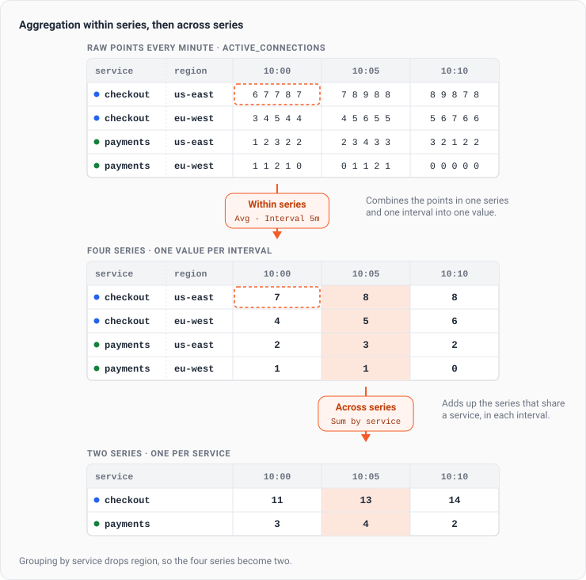
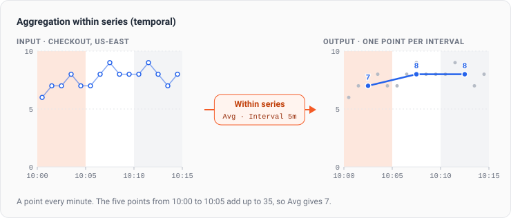
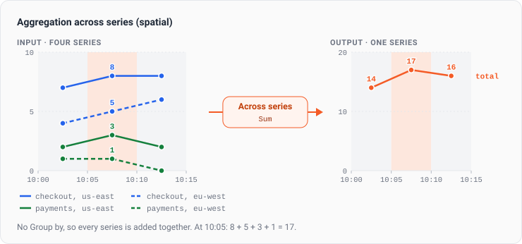
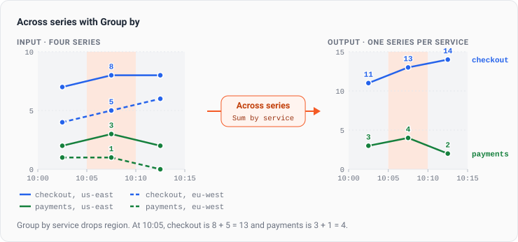

This section explains how KloudMate handles common metric types and how aggregation behaves in Explore.

## Supported Metric Types

KloudMate supports the following OpenTelemetry metric types:

- Gauge
- Sum
- Histogram
- Exponential Histogram
- Summary

Refer to the [OpenTelemetry Data Model](https://opentelemetry.io/docs/specs/otel/metrics/data-model/) for underlying data model concepts.

## Temporality

Both Delta and Cumulative temporalities are supported across all applicable metric types.

## How aggregation works

A metric query aggregates in two steps. **Aggregation within series** combines the points of each series into one value per interval. **Aggregation across series** then combines those series into the result the panel draws. These steps are also known as temporal and spatial aggregation.

A series is one combination of attribute values. For example, `active_connections` reported with a `service` attribute (`checkout` or `payments`) and a `region` attribute (`us-east` or `eu-west`) makes four series, one for each service in each region.

Choosing a single function such as **Avg** or **Sum** in the Query Builder covers most queries. Click **Customize aggregation** to pick the operation for each step yourself.

## Aggregation within series

Aggregation within series reduces the points of one series in each interval to a single value. **Interval** sets the length of each interval. For example, with a 5-minute interval and a point every minute, each interval holds five points, and **Avg** returns their mean.

Each series is aggregated on its own, so a query that matches four series still has four series after this step.

The right operation depends on the metric type. For a [gauge](./gauge/), use **Avg**, **Min**, **Max**, or **Last**. For a [sum](./sum/) such as a request counter, use **Rate** or **Increase**.

## Aggregation across series

Aggregation across series combines the series in each interval. Without **Group by**, every matching series is combined into one. For example, **Sum** adds the four `active_connections` series into a single total.

### Keep one series per group

**Group by** keeps one result for each value of the attributes you pick, and combines only the series that share that value. For example, grouping by `service` adds the `us-east` and `eu-west` series of each service together, so the four series become two. The `region` attribute isn't in the result.

Grouping by both `service` and `region` keeps all four series, because each series already has its own combination of the two.

To keep only the series whose value matches a condition between the two steps, use [Where value](../../dashboards/adding-a-panel/queries-and-data-sources/#filter-by-value).
